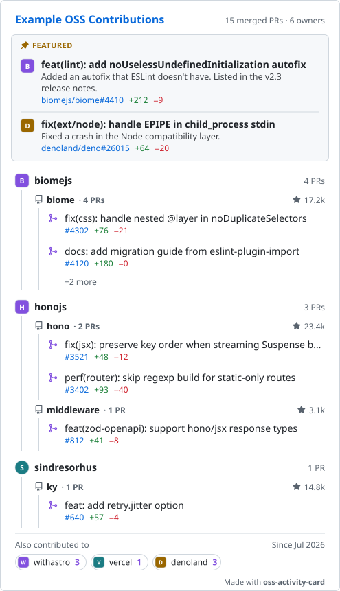

# OSS Activity Card

[](https://github.com/yamamoto7/oss-activity-card/releases)
[](LICENSE)

Show the pull requests you've had merged into other people's open source projects on your GitHub profile.

<picture>
  <source media="(prefers-color-scheme: dark)" srcset="examples/card-dark.svg">
  
</picture>

<sub>This example uses sample data. See it live, with clickable rows, on [@yamamoto7's profile](https://github.com/yamamoto7).</sub>

- **Your contributions, not your stats.** The card shows which projects merged your work and what it was, grouped by organization and repository, with each repository's star count.
- **Every row is a link.** PRs, repositories and owners each open their own page on GitHub, which an image in a README normally can't do.
- **Runs in your own repository.** A workflow regenerates the card daily and commits it. There's no server to go down or rate-limit you, and no token to set up.

## Quick start

In your profile repository (the one named after your username, `<you>/<you>`):

1. Add this as `.github/workflows/oss-card.yml`:

   ```yaml
   name: OSS activity card
   on:
     schedule:
       - cron: "17 0 * * *" # daily
     workflow_dispatch:
     push:
       paths: [.github/oss-card.yml]
   permissions:
     contents: write
   jobs:
     card:
       runs-on: ubuntu-latest
       steps:
         - uses: actions/checkout@v5
         - uses: yamamoto7/oss-activity-card@v1
           with:
             readme: README.md
         - name: Commit the card if it changed
           run: |
             git config user.name "github-actions[bot]"
             git config user.email "41898282+github-actions[bot]@users.noreply.github.com"
             git add -A oss-card.svg oss-card-dark.svg oss-card/ README.md
             git diff --cached --quiet || (git commit -m "Update OSS activity card" && git push)
   ```

2. Add these two lines to your `README.md` where the card should appear:

   ```html
   <!-- oss-card:start -->
   <!-- oss-card:end -->
   ```

3. Run the workflow once from the **Actions** tab (**Run workflow**). After that it runs daily.

That's it. The default `GITHUB_TOKEN` is enough, since only public data is read.

To choose which owners come first, how many are shown, or which PRs are pinned at the top with a note, add [`examples/oss-card.yml`](examples/oss-card.yml) as `.github/oss-card.yml` and edit it. See [Configuration](#configuration). The workflow reruns whenever you change it. The same workflow with comments is in [`examples/workflow.yml`](examples/workflow.yml).

## How it works

The action searches GitHub for your merged pull requests, renders the card as SVG files in light and dark themes, and writes them into your repository. The workflow then commits them.

### Linked card

An image in a README can link to only one place, and links inside an SVG don't work there. So with the `readme` input, the card is also cut into one image per row, and these rows are wrapped in links:

| Row | Links to |
| --- | --- |
| Featured PR, PR | The pull request |
| Repository | The repository |
| Owner | The owner's GitHub page |
| Header, "Made with oss-activity-card" | This project. With `credit: false`, the credit line is removed and the header has no link. |

The "+N more" rows and footer have no link. PR numbers are drawn in GitHub's link color, since a README image can't change on hover.

The rows are written to `oss-card/` and put between the two markers, replacing what was there. Each row has the PR title or name as its alt text and tooltip. The rows line up without gaps, so the card looks the same as the single image.

The card is 495px wide. Where the README is narrower, such as on a phone, every row shrinks by the same ratio, so the card shrinks as one image. It doesn't grow past 495px, and text doesn't reflow, since each row is an image.

### Single image

The workflow also writes the whole card as `oss-card.svg` and `oss-card-dark.svg`. To use it as one image, drop the `readme` input and add this to your README instead. The image links to this project; change or remove the `<a>` if you like.

```html
<a href="https://github.com/yamamoto7/oss-activity-card">
  <picture>
    <source media="(prefers-color-scheme: dark)" srcset="./oss-card-dark.svg">
    
  </picture>
</a>
```

## What is counted

- Merged pull requests you authored, in public repositories you don't own.
- Pull requests to your own repositories are never counted. Repositories in organizations you belong to are counted. Use `exclude` or a negative `priority` if you don't want them.
- GitHub's search API returns up to 1,000 results, so at most your 1,000 most relevant merged PRs are considered.

## Configuration

Every key is optional.

```yaml
title: "{user}'s OSS Contributions"   # {user} becomes your username
since: auto                           # or a date like 2024-01-01

groups:
  repos: true       # repo headings with star counts: true, false, or auto (only owners with 2+ repos)
  sort: recent      # tie-breaker for equal priority: recent or count
  max_owners: 5     # null shows every owner
  max_prs: 2        # PRs per group (per repo when repo headings are shown)
  max_badges: 12    # owners past max_owners shown as badges in the footer; 0 for a one-line summary

priority:
  default: 0        # for owners you don't list; -1 shows only what you list
  owners:
    my-favorite-org: 10
    old-hackathon-team: -1
  repos:
    another-org/main-repo: 3

featured:
  - pr: my-favorite-org/core#1234
    note: Rewrote the config loader; now used by every plugin.

exclude:
  - some-org
  - another-org/sandbox
  - my-favorite-org/core#999

credit: true        # "Made with oss-activity-card" at the bottom; false removes it
```

### Ordering and visibility

- Owners are sorted by priority, highest first. Owners with the same priority are sorted by `groups.sort`: `recent` puts the owner with the most recently merged PR first, and `count` puts the owner with the most PRs first.
- An owner you don't list gets `priority.default`. A negative priority hides the owner.
- With `default: -1`, only the owners you list are shown. A repository listed under `priority.repos` with a priority of 0 or more is shown even when its owner isn't listed. For example, `some-org/one-repo: 1` shows that one repository without the rest of `some-org`.
- `priority.repos` also orders the repository headings within an owner. A negative value hides that repository.
- Owners cut off by `max_owners` are shown in the footer under "Also contributed to", as badges with the avatar, name and number of PRs, in the same order. `groups.max_badges` limits how many badges are drawn, and the rest are summed up in a "+N more" badge. With `max_badges: 0`, the footer shows a one-line summary instead, such as "+8 more owners · 46 PRs".

### Repository headings

By default, PRs under each owner are grouped by repository, and each heading shows the repository's star count (for example ★ 23.4k), as of the last workflow run. With `repos: false`, PRs are listed directly under the owner as `owner/repo#123`. With `repos: auto`, headings are added only for owners with two or more repositories.

### Featured PRs

`featured` PRs appear at the top of the card with an optional one-line note. They are always shown, even when `since`, `exclude` or `priority` would hide them. They still count toward their owner's and repository's PR counts, and they are listed in the groups after the other PRs, so they only take one of the `max_prs` slots when there is room. Otherwise they are included in "+N more". A featured PR doesn't have to be in your search results. It's looked up directly, so it can be any public PR.

### `since`

PRs merged before `since` are not counted. The footer shows `Since <month>`. With `since: auto`, everything is counted and the footer shows the month of your earliest counted PR.

## Action inputs

| Input | Default | Description |
| --- | --- | --- |
| `github-token` | `${{ github.token }}` | Token used to call the GitHub API. |
| `user` | repository owner | Whose PRs to show. |
| `config` | `.github/oss-card.yml` | Path to the config file. |
| `output` | `oss-card.svg` | Light-theme SVG path. |
| `output-dark` | `oss-card-dark.svg` | Dark-theme SVG path, or `none` to skip it. |
| `readme` | (none) | README to put the [linked card](#linked-card) into, between the markers. |
| `slices-dir` | `oss-card` | Directory for the linked card's per-row images. |

Outputs: `path` and `path-dark`.

## Notes

- Avatars are embedded in the SVG as data URIs, because GitHub doesn't load external images inside SVGs shown in a README. Each avatar adds a few KB.
- SVG text can't wrap or add an ellipsis by itself, so long titles are cut using estimated character widths. The estimate leaves a small margin, so a title may end slightly before the edge.
- The light and dark colors follow GitHub's Primer palette.

## Development

Contributions are welcome. See [CONTRIBUTING.md](CONTRIBUTING.md).

Requires Node.js 24.

```sh
npm install
npm test             # unit tests (node --test)
npm run typecheck
npm run build        # bundles src/ into dist/index.js, which the action runs
npm run example      # renders examples/card-*.svg from sample data
```

To render a card for a real user locally:

```sh
GITHUB_TOKEN=$(gh auth token) INPUT_USER=<username> node dist/index.js
```

`dist/` is committed because GitHub runs the action from the repository as-is. CI fails if `dist/` doesn't match the source.

### Branches and releases

- Work happens on `dev`. To try changes on a real profile before releasing, point the workflow there with `uses: yamamoto7/oss-activity-card@dev`.
- To release, merge `dev` into `main`, then push a version tag:

  ```sh
  git switch main && git merge --ff-only dev && git push
  git tag -m v1.5.0 v1.5.0 && git push origin v1.5.0
  ```

- The [release workflow](.github/workflows/release.yml) checks that the tag is on `main`, runs the tests, checks `dist/`, creates the GitHub Release with generated notes, and moves the major tag (`v1`) to the new version.

## License

MIT. Icons are from [Octicons](https://github.com/primer/octicons) (MIT).
